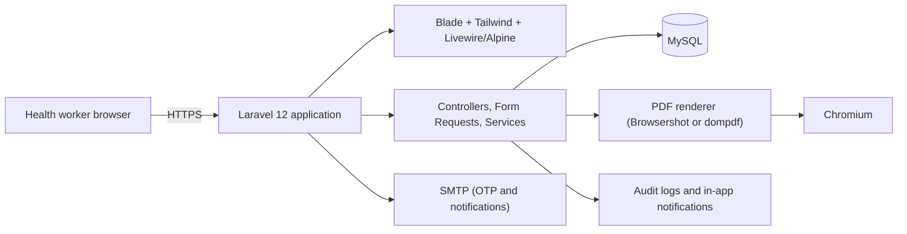
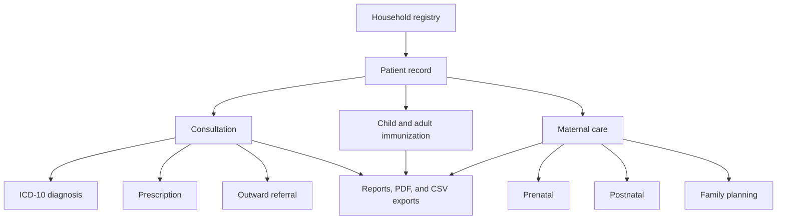

<div align="center">


# BHCIS System Sta. Ana

<p><strong>Barangay Health Center Information System</strong></p>

<p>Digital support for maternal care, immunization, consultations and referrals, medicine inventory, and barangay health reports in Barangay Sta. Ana.</p>


[Features](#features) · [Architecture](#architecture) · [Getting Started](#getting-started) · [Demo Accounts](#demo-accounts) · [Development](#development) · [Security and Privacy](#security-and-privacy) · [Troubleshooting](#troubleshooting)

</div>

> [!IMPORTANT]
> BHCIS is a college capstone project. It follows DOH-aligned workflows and print layouts, but it is **not** DOH-certified, DOH-approved, officially integrated, or affiliated with the Department of Health.

## Table of Contents

- [Overview](#overview)
- [Features](#features)
- [Architecture](#architecture)
- [Tech Stack](#tech-stack)
- [Getting Started](#getting-started)
  - [Prerequisites](#prerequisites)
  - [Create the Database](#create-the-database)
  - [Automated Setup](#automated-setup)
  - [Manual Setup](#manual-setup)
  - [Configuration](#configuration)
- [Demo Accounts](#demo-accounts)
- [Roles](#roles)
- [First-Run Walkthrough](#first-run-walkthrough)
- [Development](#development)
- [Testing and Quality](#testing-and-quality)
- [Windows Setup](#windows-setup)
- [Deployment](#deployment)
- [Security and Privacy](#security-and-privacy)
- [Troubleshooting](#troubleshooting)
- [Project Structure](#project-structure)
- [Contributing](#contributing)
- [License](#license)
- [Acknowledgements](#acknowledgements)

---

## Overview

BHCIS complements the barangay health center's paper-log workflow. It is intended for BHWs, midwives, nurses, doctors, and administrators who need a shared, searchable record of households, patients, consultations, maternal care, immunizations, and reports.

The system supports:

- Day-to-day clinical intake and documentation.
- Maternal, newborn, child, and adult health tracking.
- Referral and prescription workflows.
- Barangay-level reporting and printable forms.
- Role-based access to patient information.
- Audit logging for important clinical and administrative actions.

BHCIS does not replace official DOH processes, reporting systems, or clinical judgment. Health workers remain responsible for verifying records against official documents.

## Features

### Patient and household registry

- Zone-based household registry with member management.
- Patient records with shared search and archive, restore, and permanent-delete controls.
- Death records linked to patient profiles.
- Bulk zone updates and CSV/PDF household exports.
- Batch entry for digitizing existing paper forms.

### Consultations and referrals

- Consultation intake with queue and status tracking.
- Versioned vital signs so corrections are traceable.
- Chief complaint, ICD-10 diagnosis, and prescription recording.
- Consultation finalization and printable handouts.
- Outward referrals with status updates and printable referral forms.

### Maternal care

- Prenatal profiles and pregnancy tracking.
- Prenatal visit records with risk escalation support.
- Postpartum and postnatal visit tracking.
- Family planning client management with visit logging and printable records.

### Immunization

- Child and adult immunization schedules.
- Vaccine administration, batch administration, and marked-as-done tracking.
- No-show handling and infant enrollment.
- Printable immunization record cards using DOH-aligned layouts.

### Medicines and reports

- Medicine inventory with import, soft delete, restore, and bulk actions.
- Morbidity and MCH-EPI-FP reports.
- PDF downloads and CSV exports for supported reports.

### Administration and access

- Role-specific dashboards for BHWs, midwives, nurses, doctors, and administrators.
- User, role, and data-driven permission management.
- Zone management and activity logs.
- Application settings, backup export/import, and privacy policy settings.
- In-app notifications and audit-logged actions.

### Authentication

- Session-based login with idle-session handling.
- Forgot-password flow using OTP sent through SMTP.
- Theme preference persistence, including a dark theme.

## Architecture

BHCIS is a server-rendered Laravel application. Controllers stay thin, validation lives in Form Requests, and domain logic lives in services.



The main clinical flows share the same patient and household records:



Key request path:

1. `routes/web.php` applies authentication and permission middleware.
2. A controller validates the request through a Form Request.
3. A service performs the domain work and writes audit logs where required.
4. Blade renders the app shell, or the PDF service renders a print form.
5. Results are stored in MySQL and optionally exported.

## Tech Stack

| Layer | Technology |
| --- | --- |
| Backend | Laravel 12, PHP 8.2+ |
| UI | Blade, Tailwind CSS v4, Livewire 3, Alpine.js, Vite |
| UI libraries | SweetAlert2, ApexCharts, Font Awesome 7 |
| PDFs | `spatie/laravel-pdf` with Browsershot/Puppeteer, `barryvdh/laravel-dompdf` |
| Database | MySQL 8+ in normal use, in-memory SQLite for tests |
| Authentication | Session-based authentication with a custom controller and OTP password reset |
| Email | SMTP, including Gmail App Passwords for OTP delivery |
| Tooling | Laravel Pint, Larastan/PHPStan, PHPUnit, Laravel Pail |
| Deployment | Vercel configuration included (`vercel.json`) |

## Getting Started

### Prerequisites

- PHP **8.2+**.
- [Composer](https://getcomposer.org) 2.
- [Node.js](https://nodejs.org) **20.19+** or **22.12+** (required by Vite 7).
- MySQL 8+.
- Chromium or Google Chrome for Browsershot PDF rendering. Puppeteer normally downloads a compatible browser during `npm install`.

**Required PHP extensions:**

- `pdo_mysql`
- `mbstring`
- `openssl`
- `curl`
- `xml`
- `bcmath`
- `gd`
- `zip`
- `pdo_sqlite` (required by the test suite)

On **Ubuntu/WSL**, install them with:

```sh
sudo apt install php8.2-mysql php8.2-mbstring php8.2-xml php8.2-curl php8.2-gd php8.2-zip php8.2-bcmath php8.2-sqlite3
```

On **Windows**, enable the same extensions in `php.ini` by removing the `;` before each `extension=...` line.

### Create the Database

The automated setup script does **not** create the MySQL database. Create it first:

```sql
CREATE DATABASE bhcis CHARACTER SET utf8mb4 COLLATE utf8mb4_unicode_ci;
```

For example:

```sh
mysql -u root -p -e "CREATE DATABASE bhcis CHARACTER SET utf8mb4 COLLATE utf8mb4_unicode_ci;"
```

### Automated Setup

```sh
# 1. Clone the repository
git clone https://github.com/kyowshi-dev/bhcis-main.git
cd bhcis-main

# 2. Install dependencies, create .env, generate a key, migrate, seed, and build assets
composer run setup

# 3. Start the application
composer run dev
```

`composer run setup` runs these steps:

1. `composer install`.
2. Copies `.env.example` to `.env` if `.env` does not exist.
3. Generates `APP_KEY`.
4. Runs database migrations with `--force`.
5. Seeds roles, permissions, demo users, lookup data, and demo clinical records.
6. Creates the storage symlink.
7. Runs `npm install` and `npm run build`.

Open [http://localhost:8000](http://localhost:8000) after the development server starts.

> [!WARNING]
> The default seeder creates demo users and demo clinical records. Do not run it against a production database. See [Demo Accounts](#demo-accounts) for the production seeding rules.

### Manual Setup

<details>
<summary>Show the manual setup commands</summary>

```sh
composer install

cp .env.example .env
php artisan key:generate

# Edit .env and set the database and mail values before migrating.
php artisan migrate --seed

php artisan storage:link

npm install
npm run build

php artisan serve
```

For production, avoid the default demo seeder. Run the migrations and provision roles, permissions, users, and lookup data through your deployment procedure:

```sh
php artisan migrate --force
```

</details>

### Configuration

The `.env` file is created from `.env.example` during setup. Review these values for your environment:

| Variable | Default | Notes |
| --- | --- | --- |
| `APP_NAME` | `BHCIS` | Display name used by the application. |
| `APP_ENV` | `local` | Use `production` for deployed environments. |
| `APP_DEBUG` | `false` | Never enable in production. Debug output can expose patient data. |
| `APP_URL` | `http://localhost` | Set the public URL in production. |
| `SESSION_ENCRYPT` | `true` | Encrypts PHI-bearing session payloads at rest. |
| `SESSION_SECURE_COOKIE` | `null` | `null` auto-detects HTTPS. Force `true` in production. |
| `TRUSTED_PROXIES` | `127.0.0.1,::1` | Use `*` behind a trusted reverse proxy, Vercel, or a tunnel. |
| `INITIAL_USER_PASSWORD` | unset | Required before seeding users in production. |
| `DB_CONNECTION` | `mysql` | Use `sqlite` only for local experiments or tests. |
| `DB_HOST` / `DB_PORT` | `127.0.0.1` / `3306` | MySQL connection details. |
| `DB_DATABASE` | `bhcis` | Must exist before running migrations. |
| `DB_USERNAME` / `DB_PASSWORD` | `root` / empty | Use a dedicated database user in production. |
| `MAIL_MAILER` | `smtp` | Required for OTP password reset and email notifications. |
| `MAIL_HOST` / `MAIL_PORT` | `smtp.gmail.com` / `587` | Adjust for your mail provider. |
| `MAIL_USERNAME` / `MAIL_PASSWORD` | BHCIS SMTP account / empty | Use a Gmail App Password, not the account password. |
| `MAIL_FROM_ADDRESS` | `smtp.bhcis@gmail.com` | Sender address for outgoing mail. |
| `LARAVEL_PDF_DRIVER` | `browsershot` | Use `dompdf` only if Browsershot is unavailable. |
| `LARAVEL_PDF_CHROME_PATH` | unset | Set when Chrome or Chromium is not auto-detected. |
| `LARAVEL_PDF_NODE_BINARY` | unset | Set when Node is not on the web server's PATH. |
| `PUPPETEER_SKIP_DOWNLOAD` | unset | Set to `true` when the Chromium download is blocked by the network. |

## Demo Accounts

Demo accounts are available after seeding outside production. Unless `INITIAL_USER_PASSWORD` is set, they all use the password `password123`.

| Role | Username | Email |
| --- | --- | --- |
| Admin | `admin` | `admin@bhcis.com` |
| Nurse | `nurse` | `nurse@bhcis.com` |
| Doctor | `doctor` | `doctor@bhcis.com` |
| Midwife | `midwife` | `midwife2@bhcis.com` |
| BHW | `bhw1` | `bhw1@bhcis.com` |

<details>
<summary>Show all seeded demo accounts</summary>

| Role | Username | Email |
| --- | --- | --- |
| Admin | `admin` | `admin@bhcis.com` |
| Nurse | `nurse` | `nurse@bhcis.com` |
| Doctor | `doctor` | `doctor@bhcis.com` |
| Midwife | `midwife` | `midwife2@bhcis.com` |
| BHW | `bhw1` | `bhw1@bhcis.com` |
| BHW | `bhw2` | `bhw2@bhcis.com` |
| BHW | `bhw3` | `bhw3@bhcis.com` |
| BHW | `bhw4` | `bhw4@bhcis.com` |
| BHW | `bhw5` | `bhw5@bhcis.com` |
| BHW | `bhw6` | `bhw6@bhcis.com` |
| BHW | `bhw7` | `bhw7@bhcis.com` |
| BHW | `bhw8` | `bhw8@bhcis.com` |

</details>

> [!WARNING]
> Change every demo password before any non-local deployment. In production, set `INITIAL_USER_PASSWORD` before seeding. The initial user seeder refuses to run without it, but the default seeder still creates demo clinical records, so prefer a dedicated production seeding process.

## Roles

Permissions are stored in the database and can be adjusted by administrators. The initial role assignments are:

| Role | Initial access |
| --- | --- |
| Admin | All modules, including households, users, roles, zones, settings, backups, privacy settings, and activity logs. |
| Nurse | Patients, consultations, referrals, medicines, immunizations, maternal care, batch entry, and handouts. |
| Midwife | Patients, consultations, referrals, immunizations, maternal care, reports, batch entry, and handouts. |
| Doctor | Patients, consultations, referrals, medicines, maternal care, and handouts. |
| BHW | Consultations, referrals, immunizations, maternal care, reports, and handouts. |

## First-Run Walkthrough

1. Log in as the demo admin.
2. Create a household, then add a patient.
3. Log out and log in as a nurse or BHW.
4. Open the patient and start a consultation.
5. Record vitals, a complaint, an ICD-10 diagnosis, and a prescription.
6. Finalize the consultation, or create an outward referral and print it.
7. Log in as a midwife to explore prenatal, postnatal, and family planning records.
8. Open Immunizations to enroll an infant and record vaccine administration.
9. Open Reports to generate a supported report and download its PDF or CSV.

## Development

```sh
composer run dev
```

This runs the Laravel development server, queue listener, Laravel Pail logs, and Vite dev server together through `concurrently`.

### Scripts

| Command | Description |
| --- | --- |
| `composer run dev` | Serve the app, queue, logs, and Vite in parallel. |
| `composer run setup` | Full setup: install, `.env`, key, migrate, seed, storage link, and frontend build. |
| `composer run test` | Clear config and run the PHPUnit test suite. |
| `composer run phpstan` | Run PHPStan static analysis through Larastan. |
| `composer run vercel` | Install frontend dependencies and build assets for Vercel. |
| `vendor/bin/pint --dirty` | Fix code style for changed PHP files. |
| `npm run dev` | Start the Vite development server. |
| `npm run build` | Build production frontend assets. Required after Blade or JavaScript changes. |

## Testing and Quality

```sh
composer run test

# Run a single test by name
php artisan test --compact --filter=testName

# Run a single test file
php artisan test --compact tests/Feature/HouseholdCreateTest.php
```

Tests use **in-memory SQLite** as configured in `phpunit.xml`. No local database setup is required for the test suite.

Run these checks before finalizing PHP changes:

```sh
composer run test
vendor/bin/pint --dirty
composer run phpstan
```

Run `npm run build` after changing Blade views or frontend assets. If you see `ViteException: Unable to locate file in Vite manifest`, the assets have not been built.

## Windows Setup

WSL2 is recommended for the smoothest experience. If you prefer native Windows, `composer run dev` should work, or you can run each service in its own terminal:

```sh
# Terminal 1 - App server
php artisan serve

# Terminal 2 - Vite dev server
npm run dev

# Terminal 3 (optional) - Queue worker
php artisan queue:listen --tries=1 --timeout=0
```

If commands fail in CMD or PowerShell, use WSL2 or run the services individually as shown above.

## Deployment

### Vercel

The repository includes a Vercel configuration (`vercel.json`) and an `api/index.php` front controller. The Vercel environment uses cookie sessions, the sync queue, and the array cache store as defined in that configuration.

Before deploying:

1. Provision a MySQL database reachable from Vercel over TLS.
2. Set production environment variables in Vercel, especially `APP_KEY`, `APP_URL`, `APP_ENV=production`, `APP_DEBUG=false`, `DB_*`, and `MAIL_*`.
3. Run migrations against the production database.
4. Set `SESSION_SECURE_COOKIE=true`.
5. Do not run the demo seeder. Provision users through a dedicated production process.

`composer run vercel` installs frontend dependencies and builds the Vite assets.

### Traditional server

A conventional Laravel deployment works for a local health center server or a shared host:

```sh
composer install --no-dev --optimize-autoloader
npm ci
npm run build

php artisan migrate --force
php artisan config:cache
php artisan route:cache
php artisan view:cache
```

Then:

- Point the web root at `public/`.
- Enable HTTPS.
- Set `APP_ENV=production` and `APP_DEBUG=false`.
- Set `SESSION_SECURE_COOKIE=true`.
- Ensure `storage/` and `bootstrap/cache/` are writable.
- Run a queue worker if queued notifications or jobs are enabled.
- Back up the database and uploaded files regularly.

## Security and Privacy

BHCIS handles personal and clinical data. Do not use real patient data in development, screenshots, demos, or test fixtures.

- Sensitive fields use encrypted casts (`app/Casts/EncryptedString.php`).
- Session payloads are encrypted when `SESSION_ENCRYPT=true`. The example environment enables it.
- Protected routes are enforced on the server with session authentication and permission middleware. Hiding a UI control is defense in depth, not a security boundary.
- Important clinical and administrative writes are recorded in the audit log.
- Sensitive actions use rate limits and server-side validation through Form Requests.
- Settings include backup export and import for administrators.
- Privacy policy and data-purpose pages are included.

For any real deployment:

- Require HTTPS.
- Set `APP_DEBUG=false`.
- Set `SESSION_SECURE_COOKIE=true`.
- Use a dedicated, least-privilege database user.
- Rotate demo credentials and never enable demo data.
- Restrict access to backups and exported patient records.
- Review access logs and audit logs regularly.

Formal compliance with the Philippine Data Privacy Act (RA 10173) and any DOH requirements remains the responsibility of the deploying organization. BHCIS is not a certified compliance product.

## Troubleshooting

| Symptom | Likely cause | Fix |
| --- | --- | --- |
| `ViteException: Unable to locate file in Vite manifest` | Frontend assets were not built. | Run `npm run build`, or use `composer run dev`. |
| `EBADENGINE` or Vite requires a newer Node version | Node is older than Vite 7 supports. | Use Node 20.19+ or 22.12+. |
| `SQLSTATE[HY000] [1049] Unknown database` | The MySQL database does not exist. | Create it with the SQL in [Create the Database](#create-the-database) and check `DB_*` in `.env`. |
| Puppeteer or Chromium download fails | Proxy or restricted network during `npm install`. | Set `PUPPETEER_SKIP_DOWNLOAD=true`, install Chrome or Chromium manually, then set `LARAVEL_PDF_CHROME_PATH`. |
| PDFs return an error or blank page | Chrome, Chromium, or Node is not available to Browsershot. | Run `npm install`, then set `LARAVEL_PDF_CHROME_PATH` and, if needed, `LARAVEL_PDF_NODE_BINARY`. |
| OTP email is not delivered | SMTP credentials or Gmail App Password are invalid. | Verify `MAIL_*` in `.env`, use a Gmail App Password, check spam, and run the queue worker if jobs are queued. |
| `419 Page Expired` | Stale session or CSRF token. | Refresh the page, sign in again, and check the session and cookie configuration. |
| `composer run dev` fails on Windows CMD or PowerShell | Shell differences or missing tools. | Use WSL2, or run the services individually as shown in [Windows Setup](#windows-setup). |
| Styles are broken on a shared link or tunnel | Assets point at `127.0.0.1:5173` because `public/hot` exists. | Stop the Vite dev server, remove `public/hot`, and run `npm run build`. |
| Permission denied on `storage/` or `bootstrap/cache/` | Incorrect file ownership or permissions. | Fix ownership and permissions; run `php artisan storage:link` if the public storage link is missing. |
| Tests try to connect to MySQL | The test command was not used. | Run `composer run test`; PHPUnit forces in-memory SQLite. |
| Port 8000 is already in use | Another server or process is running. | Stop the process or run `php artisan serve --port=8001`. |

## Project Structure

```text
app/
├── Console/Commands/          # Scheduled and notification commands
├── Enums/                     # Status and domain enums
├── Helpers/                   # Shared helpers and breadcrumbs
├── Http/Controllers/          # Thin request handlers
├── Http/Requests/             # Form Request validation classes
├── Models/                    # Eloquent models and relationships
├── Policies/                  # Authorization policies
├── Services/                  # Domain, reporting, PDF, and query logic
└── Support/                   # Small support classes

database/
├── factories/
├── migrations/
└── seeders/

resources/
├── css/
├── js/
└── views/
    ├── layouts/               # App-shell layouts
    ├── pdfs/                  # PDF report templates
    └── ...                    # Feature views

routes/
├── console.php
└── web.php                    # All web routes

tests/
├── Feature/
└── Unit/
```

Controllers should remain thin. Put reusable and domain logic in `app/Services/`, validation in `app/Http/Requests/`, and shared helpers in `app/Helpers/`.

## Contributing

Read [AGENTS.md](AGENTS.md) before changing backend behavior, clinical workflows, permissions, security headers, or UI. It documents the project conventions and verification gates.

Also review [CODE_OF_CONDUCT.md](CODE_OF_CONDUCT.md).

Before opening a change:

- Run `composer run test`.
- Run `vendor/bin/pint --dirty`.
- Run `composer run phpstan` once as a final check.
- Run `npm run build` after Blade or JavaScript changes.
- Do not commit secrets, patient data, or generated storage files.

## License

Distributed under the MIT License. See [LICENSE](LICENSE).

BHCIS is a capstone project and is not affiliated with, endorsed by, or certified by the Philippine Department of Health.

## Acknowledgements

- WHO ICD-10 Version:2019 for diagnosis code descriptions used by the local lookup table.
- Philippine DOH and iClinicSys forms as layout and workflow references.
- The Laravel, Tailwind CSS, Livewire, Alpine.js, and open-source PHP and JavaScript communities.
